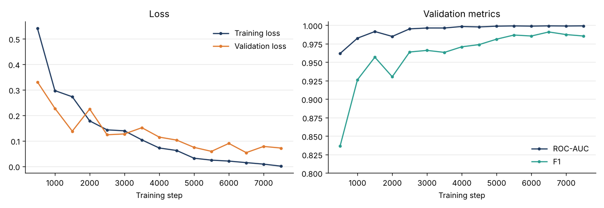

# Indic Speech Deepfake Detection

Detecting **AI-generated (text-to-speech) audio** versus real human speech across **16 Indian languages** by fine-tuning **DistilHuBERT**, a compact self-supervised speech model.

**Result: ROC-AUC 0.99999 on a held-out test set, ranked 7th of 201 teams.**

| | |
|---|---|
| Task | Binary classification: predict the probability that a clip is synthetic |
| Languages | Assamese, Bengali, Bodo, Dogri, English, Gujarati, Hindi, Kannada, Malayalam, Manipuri, Marathi, Nepali, Odia, Sanskrit, Tamil, Telugu |
| Data | [IndicTTS Deepfake Challenge dataset](https://huggingface.co/datasets/SherryT997/IndicTTS-Deepfake-Challenge-Data) 33,737 clips, about 63 hours of audio (31,102 training, 2,635 test) |
| Model | DistilHuBERT (`ntu-spml/distilhubert`) with a classification head |
| Metric | ROC-AUC |
| Result | **0.99999** on the held-out test set (7th of 201 teams); validation ROC-AUC 0.999 |

## Why this matters

Modern TTS systems produce speech that is hard to tell from a real voice, which enables voice fraud and misinformation. Detection is harder still for Indian languages, where training data is scarce. This project was part of an IIT Madras course challenge, run over a few days (8–11 March 2025) with limited free GPU time.

## Approach

1. **Language-balanced sampling.** To fit the GPU budget, 45% of the clips were taken from each language separately (13,993 of 31,102), so all 16 languages stay represented.
2. **Fixed-length audio.** Every clip is trimmed or zero-padded to **1.5 seconds** (24,000 samples at 16 kHz) and normalised to zero mean and unit variance.
3. **Fine-tuning DistilHuBERT.** The convolutional feature encoder is frozen, and the transformer layers and a two-class head are trained for 5 epochs (fp16, gradient checkpointing, learning rate 1e-4 with warm-up). 10% of the sample is held out for validation.
4. **Prediction.** Each test clip is scored at full length, and the softmax probability of the synthetic class is submitted.
5. **Combining runs.** For the final submission, models trained on different fractions of the data were combined with a weighted average of their predicted probabilities.



Validation ROC-AUC rose from 0.962 to 0.999 during training, and F1 reached about 0.99.

## Repository structure

```
indic-speech-deepfake-detection/
├── notebook/
│   └── indic_speech_deepfake_detection.ipynb   # full pipeline with outputs
├── images/                                     # chart used in this README
├── requirements.txt
└── README.md
```

The notebook loads the data directly from Hugging Face. It was run on a free T4 GPU, and training takes about 30 minutes.

## Limitations and next steps

- The model is trained on 1.5-second clips but scores test clips at full length. Scoring several 1.5-second windows and averaging them would match training more closely.
- Sampling takes the first 45% of each language's clips; a random sample per language would be more representative.
- The best checkpoint was not reloaded at the end of training, so the final-step model was used.
- Robustness to unseen TTS systems and to languages outside the training set has not been tested.

## Tech stack

Python, PyTorch, Hugging Face Transformers, Datasets and Evaluate, DistilHuBERT, NumPy, pandas
